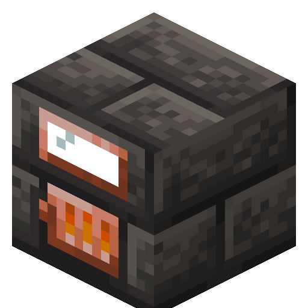

# Tinkers' Construct for Sunrise (Early Access)

Melt ores and metals in a smeltery, cast them into tool parts, and build tools, weapons and armor you can upgrade
with modifiers, with slime islands to explore, on [Sunrise](https://playsunrise.net) (Minecraft Java 26.3).

**Sunrise port by Joeypc6, based on [Tinkers' Construct](https://github.com/SlimeKnights/TinkersConstruct) by
SlimeKnights (mDiyo, boni, KnightMiner and contributors)**, together with the parts of
[Mantle](https://github.com/SlimeKnights/Mantle) (SlimeKnights) it uses. The code is a rewrite on Sunrise's mod API
that follows the original 1.20.1-3.12.1.231 release; the textures, models, recipes, books and language files are the
original's. This is an unofficial port, not made or endorsed by SlimeKnights.

**Early Access:** most of the mod works and is tested, but some parts are missing or untested. The piggyback pack
can't seat a mob yet, double jump is untested, and a few armor modifiers, the armor keys, the zoom and some fluid
effects on tools are not ported yet. Report what you find in this repository's issues.

- **Mod id:** `tconstruct`
- **Licence:** MIT, the same as the original. See [`LICENSE`](LICENSE) (Tinkers' Construct),
  [`LICENSE-Mantle`](LICENSE-Mantle) and [`NOTICE`](NOTICE).
- **Optional mods:** JEI (melting, alloying, casting, part building and modifier recipes) and GuideME (the W guide).

## Install

1. Open the Sunrise launcher and select your instance.
2. Open **Mods**, find **Tinkers' Construct** in Discover, and install it. The launcher installs what it needs and
   builds the mod for your game.
3. The mod is native code, which is not sandboxed: the launcher asks you to trust it before building it.

Each release fits the Sunrise builds it was made for; the launcher only offers it for those.

## Reporting problems

Open an issue in this repository. Please don't report problems with this port to SlimeKnights.
